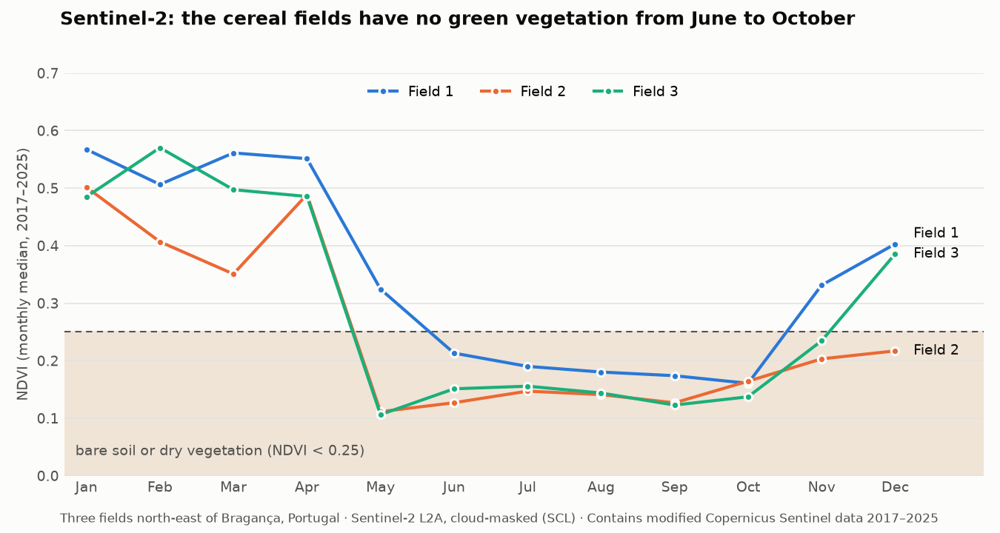

# Field Shift: Adapting Farms with NASA Data

A decision-support tool that compares crop rotations using NASA climate data and Sentinel-2 imagery.
NASA Space Apps Challenge 2026, challenge "Field Shift: Adapting Farms with NASA Data".

- Pilot site: Bragança, north-east Portugal (41.81° N, 6.76° W)
- Current farm rotation: potato → wheat → fallow
- The app, this README and `docs/ndvi_sentinel2.md` are in English. Internal identifiers in the code (dictionary keys, column names) are in Portuguese.



## How to run

```bash
python -m pip install -r requirements.txt
python run.py                     # starts the app and opens it in the browser
```

Always use `python -m ...` and `python run.py`, not the bare `pip` and `streamlit` commands. On Windows those are often not on the PATH and fail with "streamlit is not recognized". `run.py` also skips Streamlit's first-run prompt asking for an email. If `python` is not recognised on Windows, use `py` instead.

The Bragança data is already in `data/`. To regenerate it (run from the project folder):

```bash
python scripts/fetch_power.py     # downloads NASA POWER, 2000 to 2025 (about 30 s)
python scripts/indicators.py      # recomputes the indicators and scores
python -m pip install pytest      # tests only
python -m pytest -q               # 17 tests
```

The app needs internet access to draw the map. Everything else works offline.

The Sentinel-2 NDVI is also already in `data/`. Regenerating it needs a free [Copernicus Data Space](https://dataspace.copernicus.eu) account and an OAuth client (dashboard → User settings → OAuth clients). Credentials go in environment variables, never in the repository:

```bash
# PowerShell: $env:CDSE_CLIENT_ID="..."; $env:CDSE_CLIENT_SECRET="..."
python scripts/fetch_ndvi.py --lat 41.8387 --lon -6.7206 --half-size 25 --name braganca_field1
python scripts/fetch_ndvi.py --lat 41.8324 --lon -6.7279 --half-size 25 --name braganca_field2
python scripts/fetch_ndvi.py --lat 41.8431 --lon -6.7046 --half-size 25 --name braganca_field3
python scripts/plot_ndvi.py       # chart in docs/ndvi_braganca.png
```

## Strategies compared

- **A. Current (baseline):** potato → wheat → fallow
- **B. Legume instead of fallow:** potato → wheat → pea, lupin or faba bean
- **C. Forage instead of fallow:** potato → wheat → lucerne or clover
- **D. Hardy cereal:** potato → rye or oats → legume

For each one the app shows why it is proposed, the evidence, the expected benefits, what we do not know yet, and the risks to check with a local agronomist.

## How it works

1. **What the data says about the site** (`fieldshift/indicators.py`, `climate_indicators`). Per year: rainfall, temperature, frost days, heavy-rain days (20 mm or more) and anomalies against the 2000–2025 mean. Each year is labelled dry (driest 20%), heavy-rain (20% with most heavy-rain days) or normal.
2. **How exposed each rotation is** (`crop_year_table`, `strategy_year_table`). A calendar per crop says when the soil is covered, when the crop needs water and when it is frost-sensitive. Four indicators per year come out of it:
   - bare-soil days;
   - heavy rain falling on bare soil (mm), as a proxy for erosion risk;
   - water deficit (mm): a daily balance between rainfall and crop demand (Hargreaves reference evapotranspiration × crop coefficient), with soil storing up to 100 mm;
   - frost days during sensitive stages.
   Each rotation phase covers one third of the farm, so a strategy's value is the mean of its three crops.
3. **Weighted score** (`fieldshift/scoring.py`). Each criterion (water, revenue, erosion, soil organic matter, frost) becomes a 0–1 sub-score against a fixed scale. The score is the sum of the sub-scores weighted by the farmer's priorities, from 0 to 100. Uncertainty is shown three ways: the range the score stays in 8 years out of 10, the share of years each strategy comes first, and a test with low and high margins.
4. **SI component: particle swarm optimisation** (`fieldshift/pso.py`). A PSO written in numpy searches the space of priority weights to answer two questions: how much would the priorities have to change for first place to change, and which priorities explain the ranking the farmer already prefers. The score itself does not depend on the PSO; the PSO makes the result explainable and shows how robust it is.
5. **App** (`app.py`). A one-page Streamlit app with a map, priority sliders, farm constraints (potato irrigation, an outlet for forage), scenarios (all years, dry years, heavy-rain years, a single year), editable margins and validation warnings.
6. **Satellite check** (`scripts/fetch_ndvi.py`). Monthly Sentinel-2 L2A NDVI from 2017 to 2025 for three cereal fields north-east of Bragança (50 m squares, cloudy pixels removed using the SCL scene classification). It checks the bare-soil months in the wheat calendar. It is not part of the score.

## Results (equal priorities)

| Scenario | 1st | 2nd | 3rd | 4th |
|---|---|---|---|---|
| All years (26) | D (69) | B (67) | C (65) | A (60) |
| Dry years (6) | D (71) | C (69) | B (69) | A (65) |
| Heavy-rain years (7) | D (64) | B (63) | C (60) | A (54) |

The gaps between B, C and D are small and change with the priorities. What holds firmly is that the current rotation comes last in all three scenarios: replacing the fallow cuts bare-soil days from 250 to 158–184 a year. The PSO shows that moving 8% of the total weight (from water to organic matter) is enough to put the forage strategy first, so first place is fragile.

## NDVI results

- From July to September all three fields have no green vegetation (median NDVI below 0.25), as the wheat calendar says (soil uncovered from 11 July to 30 November). At the edges the calendar fits less well: NDVI already drops in May and June as the grain ripens and dries, and in some years vegetation is back in October and November.
- On average a cereal field spends 6.4 months a year below 0.25 (about 195 days).
- In winter NDVI is between 0.35 and 0.57: the soil is almost never bare, but the cover is sparse (a lush pasture would be 0.7–0.9). This casts doubt on the assumption that fallow land stays bare all year, without disproving it, because we do not know which crop was on each field in each year.
- Low NDVI does not distinguish bare soil from dry stubble, which still protects the soil.

Full method and limitations: [`docs/ndvi_sentinel2.md`](docs/ndvi_sentinel2.md).

## Project structure

```
field_shift/
├── README.md
├── requirements.txt
├── run.py                   # entry point: python run.py
├── app.py                   # Streamlit app
├── fieldshift/
│   ├── config.py            # crops, strategies, thresholds and assumptions (edit here)
│   ├── indicators.py        # climate, crop and strategy indicators
│   ├── scoring.py           # weighted score and uncertainty
│   └── pso.py               # SI component (PSO over the weights)
├── scripts/
│   ├── fetch_power.py       # NASA POWER download
│   ├── indicators.py        # builds the tables in data/
│   ├── fetch_ndvi.py        # Sentinel-2 NDVI (Copernicus), needs credentials
│   └── plot_ndvi.py         # NDVI chart in docs/
├── data/                    # generated CSV files
├── tests/test_core.py
├── docs/                    # NDVI write-up and chart, app screenshots
└── notebooks/               # exploratory analysis (empty)
```

## Data sources

| Source | Use | Status |
|---|---|---|
| NASA POWER (daily API, AG community) | Climate, frost, radiation, soil moisture | In use |
| Sentinel-2 L2A (ESA Copernicus Data Space) | NDVI, check of bare-soil months | In use (three fields, 2017–2025) |
| SoilGrids (ISRIC) | Texture, organic matter, available water | Not integrated |
| SRTM | Slope, for erosion risk | Not integrated |
| IPMA (Portuguese weather service) | Validation of temperature and rainfall | Not done |
| OpenStreetMap | Map background | In use |

Attributions:

- NASA POWER: "These data were obtained from the NASA Langley Research Center (LaRC) POWER Project funded through the NASA Earth Science/Applied Science Program."
- Sentinel-2: "Contains modified Copernicus Sentinel data 2017–2025." Free and open data.
- Map: © OpenStreetMap contributors (ODbL licence; folium shows the credit on the map).

## Use of AI (SI) tools

Much of the code and documentation was written with Claude (Anthropic) as a coding assistant, directed and reviewed by the team. This includes the indicators, scoring, PSO, the Streamlit app, the Sentinel-2 NDVI scripts, the NDVI chart and this README. The problem framing, the choice of pilot site and current rotation, and the decisions above were made by the team. All agronomic and market values in `fieldshift/config.py` are working assumptions, not AI-verified facts.

## Assumptions to check with a local agronomist

All of them are in `fieldshift/config.py`:

- crop calendars (soil cover, water-demand season, frost-sensitive stage);
- fallow leaves the soil bare all year (the winter NDVI casts doubt on this, see above);
- heavy-rain threshold (20 mm a day) and soil available water (100 mm);
- crop coefficients and organic-matter index per crop;
- nitrogen fixed by legumes;
- margins per crop (low, central, high), which are manual estimates.

## Limitations

- Climate and satellite data measure conditions, not the real effect of the rotations on the soil. The effect comes from general agronomic literature and needs validation by local experts.
- NASA POWER has a grid of about 50 km: regional context, not field-level.
- Bare-soil days come from crop calendars. The Sentinel-2 NDVI only checks them in three cereal fields, without knowing which crop was on each field in each year.
- Revenue does not vary with the weather: a dry year does not lower the margin.
- Resolution differs between sources; harmonisation is approximate.
- Prices and yields are estimates.
- The tool supports the decision; it does not replace the farmer or the local agronomist.
