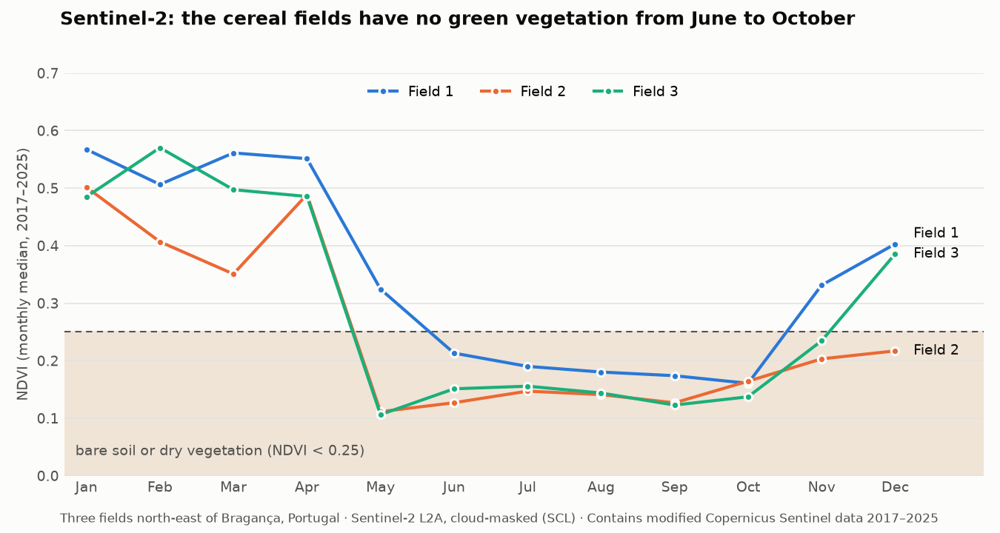

# Sentinel-2 NDVI (Copernicus)

Goal: check with satellite imagery the bare-soil months that the tool takes from
the crop calendars in `fieldshift/config.py`.



## Method

- **Source:** Copernicus Data Space Ecosystem, Sentinel-2 Level-2A (surface
  reflectance), Statistical API. 2017 to 2025, because Level-2A is only available
  regularly from 2017.
- **Sites:** three cereal fields north-east of Bragança, picked on a Sentinel-2
  image from June–July 2025 (harvested fields, away from the edges). In each one, a
  50 m × 50 m square (about 25 pixels of 10 m).

  | Field | Latitude | Longitude |
  |---|---|---|
  | 1 | 41.8387 | −6.7206 |
  | 2 | 41.8324 | −6.7279 |
  | 3 | 41.8431 | −6.7046 |

- **Clouds:** pixels that the Sentinel-2 scene classification (SCL) flags as cloud,
  cloud shadow, cirrus or snow are removed. That leaves 30 to 43 five-day windows
  with clear pixels per year and field (some with only 2 to 4 clear pixels).
- **NDVI** = (B08 − B04) / (B08 + B04). One value per five-day window, then the
  median per month. A **bare-soil month** = median NDVI below 0.25 (a rule of thumb,
  and an assumption).

## Results

| | Field 1 | Field 2 | Field 3 |
|---|---|---|---|
| Months a year with NDVI < 0.25 (mean) | 5.3 | 7.5 | 6.4 |
| Months with vegetation (median NDVI ≥ 0.4) | Jan–Apr | Jan, Feb, Apr | Jan–Apr |
| Sharp drop | May | May | May |
| Back above 0.25 | Nov | after Dec | Dec |

1. **No green vegetation in August and September in every year and every field;
   July in 25 of 27 field-years.**
   The wheat calendar in `fieldshift/config.py` (soil uncovered from 11 July to
   30 November) matches the imagery from July to September. At the edges it fits
   less well: NDVI starts falling in May and June, when the grain ripens and dries
   (the crop is still standing); in October fields 1 and 3 are below 0.25 in only
   75% of years; in November field 1 already has vegetation again (0.33).
2. **On average 6.4 months a year below 0.25**, about 195 days a year in a cereal
   field.
3. **In winter the soil is almost never bare, but the cover is sparse.** NDVI from
   January to April is between 0.35 and 0.57: partial vegetation, far from a lush
   pasture (0.7 to 0.9). Only in 3 of 27 field-years did December–March NDVI fall
   below 0.25 (field 2 in 2017 and 2020, field 3 in 2017; 2017 was a severe drought
   year). If any of these fields was fallow in one of those years, the fallow had
   some spontaneous vegetation in winter. The assumption that **fallow leaves the
   soil bare all year** (the main reason the current rotation has 250 bare-soil days
   a year) was confirmed by an agronomist from the Bragança region; this result does
   not contradict it, because we do not know whether any of these fields was
   actually fallow. It does suggest checking how much spontaneous cover a fallow
   field gets in wet winters.
4. **The year matters.** Field 2 had 11 months below 0.25 in 2017 and only 4 in
   2024. A single year says little; several years are needed.

## Limitations

- **Low NDVI is not the same as bare soil.** Stubble and dry grass also give NDVI
  below 0.25 and protect the soil from erosion. In summer the satellite shows "no
  green vegetation", not necessarily "uncovered soil".
- **We do not know which crop was on each field in each year.** NDVI cannot tell
  harvested wheat from dry fallow. That would need the crop declarations (the IFAP
  land-parcel register) or talking to the farmers.
- **Three fields do not represent the region.** They check the calendar; they do
  not measure the bare-soil area of the municipality.
- **Field selection.** The fields were picked because they were harvested in
  summer 2025, so a bare 2025 summer is expected. The other eight years played no
  part in the choice, but the check is not independent for 2025.
- **Simple cloud mask.** SCL classes 7 (unclassified) and 1 (saturated) are kept,
  and a five-day window with few clear pixels counts as much as a clear one. In
  winter, with more cloud, this can pull NDVI down.
- The 0.25 threshold is a rule of thumb. With 0.3, June to October stay below in
  all three fields; with 0.2, June in field 1 (0.21) counts as vegetated.

## How to reproduce

Run from the project folder:

```
# Copernicus credentials (dashboard > User settings > OAuth clients)
$env:CDSE_CLIENT_ID="..."; $env:CDSE_CLIENT_SECRET="..."

python scripts/fetch_ndvi.py --lat 41.8387 --lon -6.7206 --half-size 25 --name braganca_field1
python scripts/fetch_ndvi.py --lat 41.8324 --lon -6.7279 --half-size 25 --name braganca_field2
python scripts/fetch_ndvi.py --lat 41.8431 --lon -6.7046 --half-size 25 --name braganca_field3
python scripts/plot_ndvi.py
```

Each run takes under a minute. Credentials stay in environment variables and never
go into the repository.

**Terms of use:** Sentinel data is free and open (Copernicus data licence); the
required attribution is "Contains modified Copernicus Sentinel data 2017–2025".
